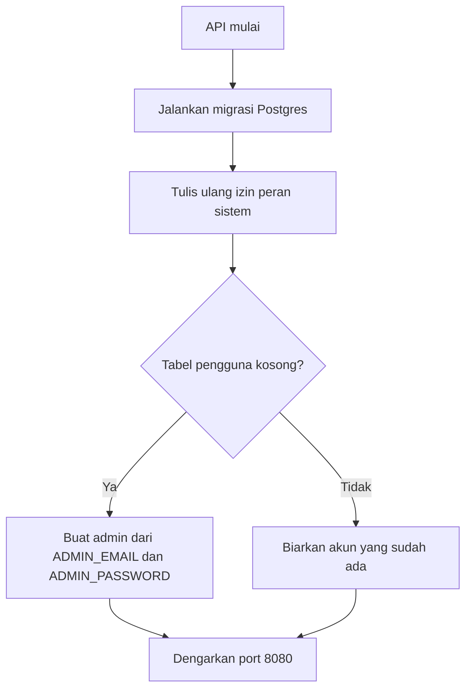
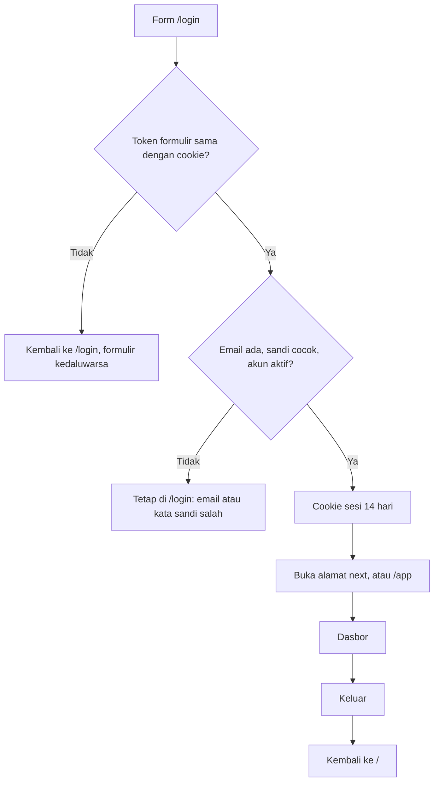
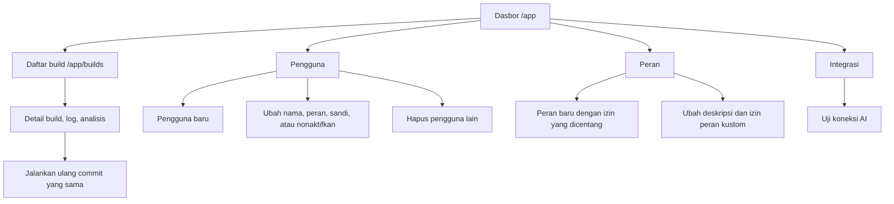
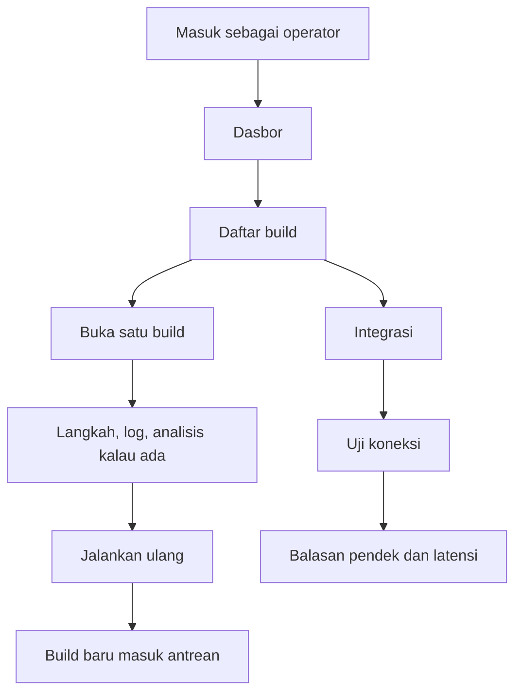
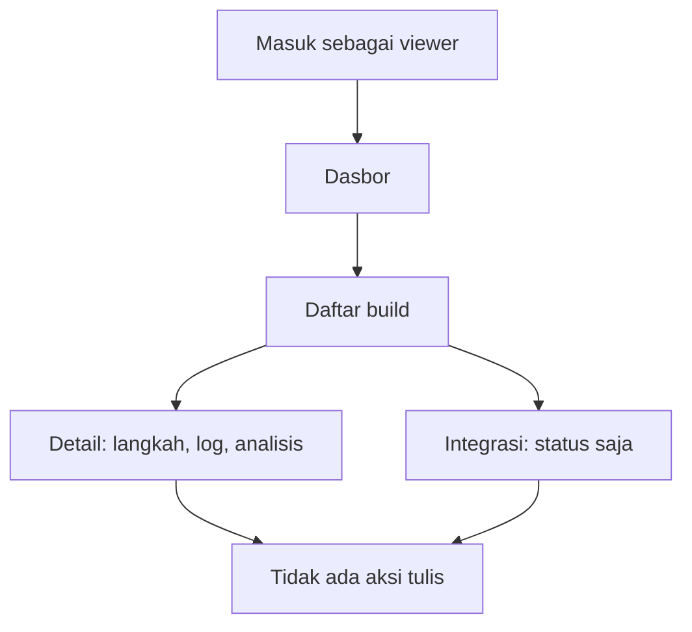
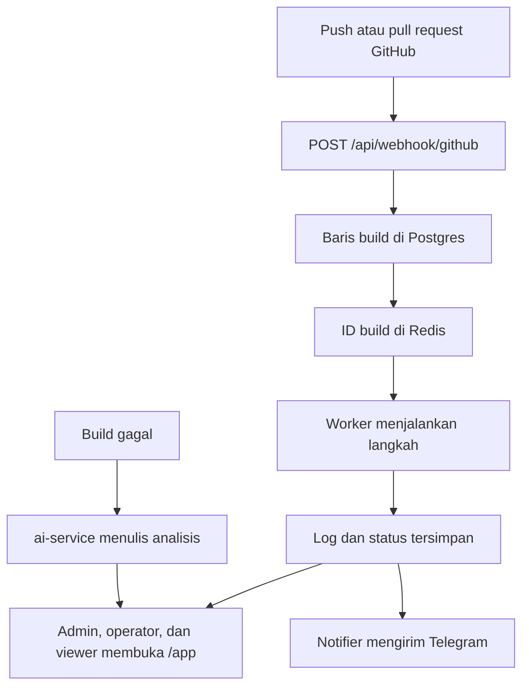

# Alur konsol

Siapa yang membuka Opsora, apa yang mereka lihat, dan ke mana tiap langkah berakhir.
Teks di layar berbahasa Indonesia. Nama izin di bawah ini sama dengan yang dicek server.

## Siapa saja

| Peran | Masuk ke `/app` | Yang bisa dilakukan |
| --- | --- | --- |
| Pengunjung | Tidak | Melihat landing page dan status AI. Tidak bisa menjalankan model. |
| `admin` | Ya | Semua izin: build, pengguna, peran, dan uji integrasi. |
| `operator` | Ya | Melihat build, menjalankan ulang, melihat integrasi, dan menguji koneksi. |
| `viewer` | Ya | Melihat build dan status integrasi. Tidak bisa mengubah apa pun. |
| Peran kustom | Ya | Hanya izin yang dicentang saat peran dibuat. |

Satu orang punya satu peran. Menu samping hanya menampilkan halaman yang izinnya dimiliki.

## Pertama kali API jalan



Nilai bawaan email adalah `admin@opsora.local` dan kata sandi `change-me`. Kata sandi tidak pernah ditulis ke log. Kalau masih memakai bawaan, API hanya mencetak peringatan. Start berikutnya tidak mengganti admin yang sudah ada.

Peran `admin`, `operator`, dan `viewer` direset dari kode setiap start. Perubahan izin pada peran sistem di basis data akan hilang. Peran kustom tidak disentuh.

## Pengunjung

```mermaid
flowchart TD
  open[Buka /] --> land[Landing page]
  land --> status[GET /api/integrations/ai]
  status --> card[Kartu status: terhubung, perlu perhatian, atau belum diatur]
  land --> login[Tombol Masuk]
  login --> form[/login]
  land --> health[Tautan Status mesin ke /health]
```

Kartu status hanya bertanya apakah layanan AI hidup dan modelnya terpasang. Generasi percobaan ada di dalam konsol, supaya pengunjung anonim tidak memuat model.

`/health` tetap JSON untuk pemeriksaan mesin. Itu bukan halaman konsol.

## Masuk dan keluar



Akun yang dinonaktifkan ditolak dengan pesan yang sama seperti sandi salah. Alamat `next` hanya diterima kalau diawali `/` dan bukan URL luar.

Tanpa sesi, setiap `/app/...` diarahkan ke `/login`. Halaman yang izinnya kurang mengembalikan orang ke `/app` dengan pesan bahwa izin tidak cukup.

## Admin

Admin adalah satu-satunya peran bawaan yang mengelola orang lain.



Membuat pengguna:

1. Buka **Pengguna**, lalu **Pengguna baru**.
2. Isi nama, email, kata sandi minimal 8 karakter, dan satu peran.
3. Email disimpan dalam huruf kecil dan harus unik.
4. Orang itu masuk lewat `/login` dengan email dan sandi tersebut.

Mengubah pengguna:

- Email tidak bisa diganti dari formulir.
- Kosongkan kata sandi kalau tidak diganti.
- Nonaktifkan akun agar sesi berikutnya ditolak.
- Admin aktif terakhir tidak bisa diturunkan perannya atau dinonaktifkan.
- Akun yang sedang dipakai tidak bisa menghapus dirinya sendiri.

Membuat peran:

1. Buka **Peran**, lalu **Peran baru**.
2. Nama: huruf kecil, angka, tanda hubung, panjang 2–32, dan bukan `admin`, `operator`, atau `viewer`.
3. Centang izin. Simpan.
4. Pasang peran itu ke pengguna lewat formulir pengguna.

Peran sistem hanya bisa dilihat. Tombol simpan dan hapus tidak muncul. Peran kustom yang masih dipakai pengguna tidak bisa dihapus sampai penggunanya dipindah.

## Operator

Operator menjalankan build. Dia tidak melihat menu Pengguna atau Peran.



`Jalankan ulang` membuat build baru untuk commit yang sama. Build lama tidak ditimpa. Kalau antrean gagal, build tetap tercatat dan layar memberi tahu bahwa build belum masuk antrean.

## Viewer

Viewer membaca hasil. Tidak ada tombol jalankan ulang, tidak ada uji koneksi, dan tidak ada menu pengguna atau peran.



Kalau viewer membuka URL pengguna atau peran langsung, server mengembalikan mereka ke dasbor.

## Peran kustom

Peran kustom dipakai ketika tiga peran bawaan terlalu kasar. Contoh: seseorang yang hanya boleh menguji integrasi, atau yang mengelola pengguna tanpa menyentuh build.

Izin yang bisa dicentang:

| Izin | Efek di konsol |
| --- | --- |
| `builds.read` | Angka dasbor, daftar build, detail, langkah, dan log |
| `builds.rerun` | Tombol jalankan ulang |
| `users.read` | Menu dan daftar pengguna |
| `users.write` | Buat, ubah, dan hapus pengguna |
| `roles.read` | Menu dan daftar peran |
| `roles.write` | Buat, ubah, dan hapus peran kustom |
| `integrations.read` | Menu integrasi dan status |
| `integrations.test` | Tombol uji koneksi |

Tanpa `builds.read`, dasbor tetap terbuka tetapi kartu build, rilis, dan analisis disembunyikan. Menu yang izinnya tidak ada tidak digambar. Daftar build ada di `/app/builds`.

## Build, dari push sampai layar

Konsol tidak menerima kode. Build masuk dari webhook, lalu orang membacanya sesuai peran.



Uji koneksi di konsol tidak mengantri build. Itu satu permintaan pendek ke layanan AI, dan hanya peran dengan `integrations.test` yang bisa menjalankannya.
